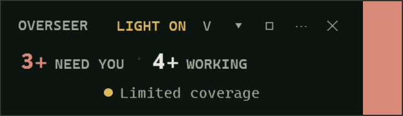
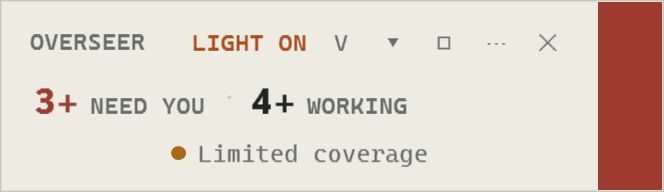

# OVERSEER — Windows HUD for AI coding agents

See what your agents are doing and when they need you, in one small Windows window.
OVERSEER groups observed work by project, shows the limits of its coverage and can
speak short notifications. It observes; it never answers requests or controls an agent.

**Publication status:** private candidate `1.0.0-rc.13` has passed automated
qualification; owner retests are pending.
The source is staged privately at [WinChurchill/the-overseer](https://github.com/WinChurchill/the-overseer)
(current work: `staging/private-upload`). There is no public download yet. GitHub Releases and a project website are prepared
for launch after [release qualification](docs/RELEASE_READINESS.md). Do not confuse
GitHub's source ZIP with the self-contained Windows application ZIP.




*Sanitized fixture screenshots with synthetic counts; these do not demonstrate live
host qualification. Both themes use the same controls and layout.*

## What it can observe

| Source | Observed work and attention | Qualification and limits |
| --- | --- | --- |
| Codex local Windows rollout files | Work, completion/error, asynchronous questions and correlated answers | Contract and packaged tests pass. Owner live-session checks pending. **Approval detection is Unsupported.** |
| DSH Desktop / DeepSeek Harness observer | Turn/tool boundaries, approval wait/resume, question wait/resume, completion/error and explicit plan mode | Experimental. Observer 1.1.0 targets Desktop 0.2.0-rc.2; missing native question metadata reduces coverage. Owner confirmed live permissions; question retest pending. Observer 1.0.0 has no question detection. |
| Claude Code desktop Code tab or editor hooks | Work, input/permission waits, resume and completion/error | Experimental. Windows-local execution only for this qualification. Actual host/engine checks pending. WSL, SSH and cloud spool routing unqualified. |

No missing source becomes a fabricated healthy zero. Monitoring details distinguish
fresh, partial, stale and unavailable coverage. Task titles and project paths may be
visible locally; no transcript is copied into OVERSEER history or diagnostic logs.
Read [privacy](PRIVACY.md) before choosing an optional network TTS provider.

Codex questions clear on a matching question-widget reply or turn completion/abort.
An answer typed as ordinary chat does not carry the question's ID, so its pending
marker can remain until the turn ends. OVERSEER does not guess from answer text.

## Install and first run

1. Obtain the versioned `OVERSEER-<version>-win-x64.zip` and its SHA-256 from the
   supplied qualification packet (later, the GitHub release).
2. Check the hash, extract the **whole folder** to a per-user location, then run
   `TheOverseer.App.exe` as a standard user. Keep its files together.
3. Start your normal Codex work. Use **Projects & sources…** for roots, mappings and
   optional bridges; use the health control for coverage and the next setup action.
4. Voice starts muted. **Light & voice…** lets you preview offline Windows speech,
   change theme/opacity and configure startup, the light and voice.

The application includes its .NET runtime: no SDK, system .NET, Node or repository
is needed to launch it. Optional bridge producers need Node in their **host execution
environment** (DSH 20+, Claude 18+); the application does not install that runtime.
Target: Windows x64. ARM64, x86, macOS and Linux are unqualified. Clean-machine/OS
build qualification is pending; tested OS and host versions will accompany a release.
The private RC is unsigned. Keep normal Windows protections enabled; record any
warning or policy block in the test results.

Runtime data is separate under `%LOCALAPPDATA%\OVERSEER`: settings, placement,
local history, recordings, spools and bounded logs. For a disposable test, launch:

```powershell
.\TheOverseer.App.exe --data-directory "C:\Users\Public\OVERSEER Test Data"
```

Choose a test folder your account owns. Bridges use their documented spool overrides
when testing isolated data; changing the app's folder alone does not redirect producers.
A no-host first run should show unknown/offline coverage and a setup action, with voice
muted. Existing settings are preserved.

## Everyday controls

- **NEED YOU / WORKING** selects the corresponding filter and expands the list.
- **Now / Recent / This session**, project groups and history strips change the view.
  Counts still summarize all observed work. Unknown history is not idle time.
- **M / V** mutes/unmutes; **LIGHT ON/OFF** toggles the status light.
- **⋯** opens eight actions: Always on top, Expand all projects, Collapse all projects,
  Compact/expanded HUD, Light & voice…, Projects & sources…, Hide to tray and Exit.
- Drag a clear header strip to move; use the border to resize. Maximize/restore and
  Windows Snap are available. Smallest supported layout is 300 × 220 DIP.
- The tray restores the HUD and offers pin, mute, settings and Exit. Closing hides
  while a usable tray exists; without one it exits. Normal status updates do not
  intentionally activate the window. Intentional restore/activation needs owner testing.
- A resolved Codex desktop task opens its `codex://threads/<id>` route. Other harnesses
  offer task-id copying. OVERSEER does not submit a response or approval.
  Windows Store activation is available when the ordinary shell has no association;
  success means an open request was accepted, not proof of the exact chat focusing.

## Optional integrations

Follow the [integration index](integrations/README.md) and the bridge-specific guides:
[DSH Desktop](integrations/deepseek-harness/README.md),
[Claude Code desktop/editor](integrations/claude-code/README.md).
Keep bridge files at a permanent path, preview/back up changes and restart OVERSEER
after install/removal/rebinding: discovery happens at startup.

DSH Desktop owns its dedicated `desktop` profile. Use its Plugins page, or its bundled
CLI **after fully quitting Desktop**; a terminal DSH profile is a separate environment.
Claude Code hooks belong to the Code settings for the session's execution environment,
not the desktop chat MCP settings. A standalone `claude` command is not required.
Installers preview by default and preserve unrelated settings; `--apply` is explicit.

## Update, rollback and uninstall

Stop the app, back up its data directory, extract the new version into a **new** folder
and start it. Repair shortcuts/startup and any bridge path that moved. Keep the old
folder and backup until accepted. To roll back, stop the app and restore that backup
before starting the old copy. See [upgrade and rollback](docs/UPGRADE_AND_ROLLBACK.md).

To uninstall, disable Start with Windows, remove installed bridge hooks/plugins using
their guides, then Exit and delete the application folder. Remaining OVERSEER data is
optional to delete after stopping producers; it includes your settings and recordings.
Unrelated host settings must remain intact.

## Build, report a bug or contribute

The [contribution guide](CONTRIBUTING.md) gives the .NET 10 / Node / PowerShell build
and test commands. [Support](SUPPORT.md) explains what to attach to a bug report;
[security reporting](SECURITY.md) explains the private route planned for publication.
Never attach raw agent sessions, credentials or your full settings/data directory.

Current results and limitations: [implementation state](docs/IMPLEMENTATION_STATE.md).
Owner tests and publication gates: [release readiness](docs/RELEASE_READINESS.md).
The project website is built locally from `site/` using `node scripts/Build-Site.mjs`;
its [build and deployment guidance](site/README.md) keeps publication gated.

Original code, docs and generated artwork: [MIT](LICENSE), copyright Winston Lin.
Adapted monitoring code retains the upstream MIT notice; redistributed .NET runtime
terms ship separately. See [third-party notices](THIRD_PARTY_NOTICES.md).
