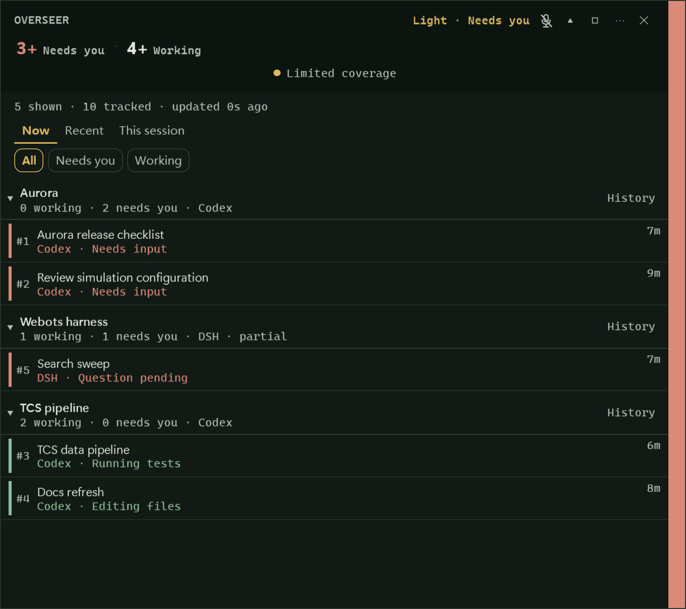
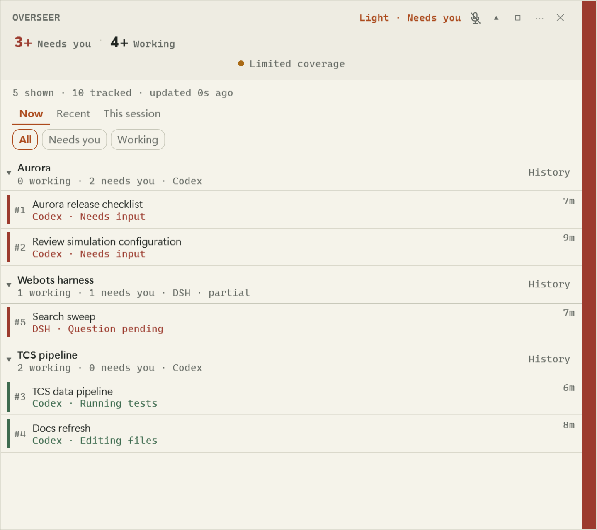

# OVERSEER

OVERSEER is a Windows HUD for AI coding agents. See which projects are active, which
tasks need input, and what happened recently. Optional voice cues announce changes.



<details>
<summary>Light theme</summary>

</details>

*App screenshots with sample tasks.*

## Run the app

For a published build, download the Windows x64 app ZIP and its checksum, verify the
hash, extract the whole folder, and open **TheOverseer.App.exe**. The ZIP includes its
.NET runtime. [Releases](https://github.com/WinChurchill/the-overseer/releases) ·
[Package instructions](docs/TESTER_HANDOFF.md#using-an-application-zip)

[Verify a download](docs/RELEASE_VERIFICATION.md) explains checksums and optional
GitHub build attestations. The alpha remains unsigned.

### Clone and run

On Windows x64, use Git, PowerShell 7, and the x64 .NET 10 SDK.
[SDK download](https://dotnet.microsoft.com/en-us/download/dotnet/10.0)

```powershell
git clone https://github.com/WinChurchill/the-overseer.git
Set-Location the-overseer
$testData = Join-Path $env:LOCALAPPDATA 'OVERSEER-Tester\source'
dotnet run --project src/TheOverseer.App/TheOverseer.App.csproj -c Release -- --data-directory "$testData"
```

The first build restores packages. The separate data folder holds tester settings,
history, and logs. The HUD still reads your local agent sources.

## Connect a source

| Source | Setup |
| --- | --- |
| Codex on Windows | Local sessions are discovered automatically. Use `--codex-home` for a different Codex home. |
| Claude Code | Install the optional experimental hooks. [Claude Code setup](integrations/claude-code/README.md) |
| Claude Projects | Enable the experimental **Observe loaded Claude Projects desktop views** option in **⋯ → Projects & sources…**, restart OVERSEER, and open **Threads / Overview** in Claude. [Coverage and limits](integrations/README.md#claude-projects-and-cloud-workers) |
| DeepSeek Harness | Install the optional experimental observer. [DSH setup](integrations/deepseek-harness/README.md) |

Start a small task and compare it with **Now**. Open the coverage indicator if a
source is missing or stale. Codex approvals are unsupported. The Claude Projects
observer covers loaded desktop overviews.

## Use the HUD

- Select **Needs you** or **Working** to filter tasks. Use **Recent** and **History**
  to inspect past activity.
- Drag the header to move the HUD. Drag the divider to resize the status light.
- Voice starts muted. Open **⋯ → Light & voice…** to preview the included offline
  Kokoro cues, then unmute when ready.
- Close hides the HUD to the tray. Choose **⋯ → Exit** to stop it.

The alpha targets Windows x64. The app ZIP is unsigned. For testing, support, or
development, see the [tester handoff](docs/TESTER_HANDOFF.md), [support](SUPPORT.md),
[contributing](CONTRIBUTING.md), and [agent instructions](AGENTS.md).

[Updates and rollback](docs/UPGRADE_AND_ROLLBACK.md) · [Privacy](PRIVACY.md) ·
[Security](SECURITY.md) · [MIT license](LICENSE) · [Third-party notices](THIRD_PARTY_NOTICES.md)

Built by Winston Lin with testers lanbodikai and qinyif001, and with help from
the AI coding agents [Claude Code](https://claude.com/claude-code),
[Codex](https://openai.com/codex/) and [DeepSeek](https://www.deepseek.com/).
